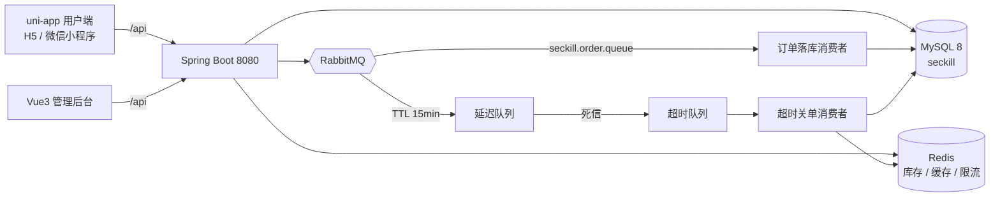
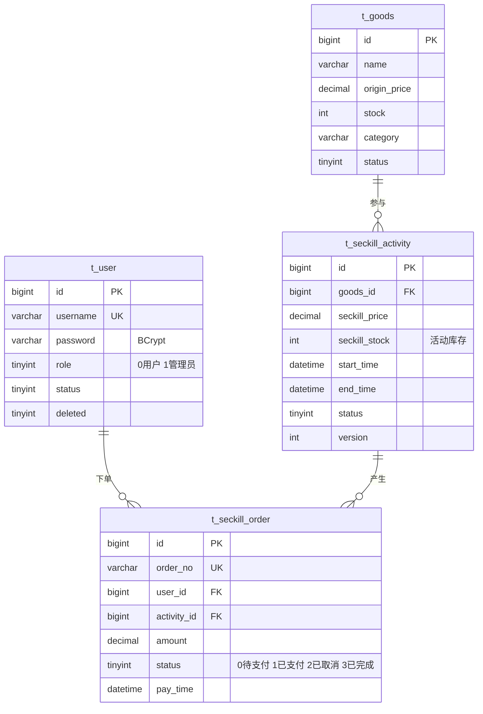
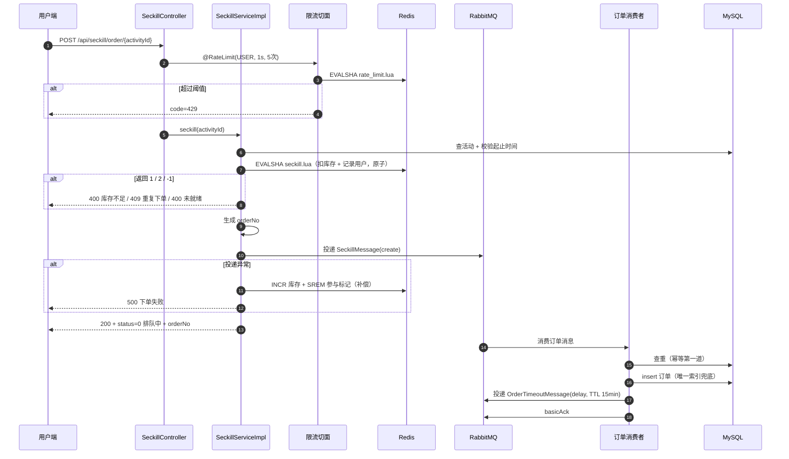
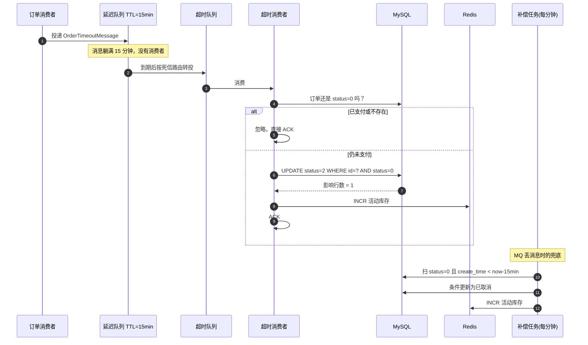

# 架构与核心链路

本文说明系统结构、并发正确性、消息与缓存设计，以及各类失败场景的兜底方式。README 负责「怎么跑」，这里负责「为什么这么写」。

---

## 1. 系统全景



- 读多写少的商品浏览直接走 MySQL + Redis 缓存
- 秒杀写路径：Redis 扣减 → MQ → 消费者落库，数据库不在请求链路上
- 时间驱动的动作（超时关单）由延迟队列触发，定时任务只做兜底

---

## 2. 代码分层

```
controller   接收请求、参数绑定、返回 Result，不做业务判断
service      业务编排（接口 + impl）
mapper       MyBatis-Plus BaseMapper，复杂 SQL 走 XML
entity       数据库实体，字段与表一一对应
dto          请求体 / MQ 消息体
vo           返回给前端的展示对象（控制字段暴露范围）
common       Result、UserContext、CacheKeys
config       RabbitMQ、WebMvc、MyBatisPlus、JWT
aspect       限流切面
listener     MQ 消费者
task         定时任务
```

几条约定：

- **Controller 不写 if/else 业务**，校验和状态判断都在 Service，异常统一抛 `BusinessException(code, message)`
- **VO 与 Entity 分离**：比如 `SeckillActivityVO` 把活动、商品、Redis 实时库存拼在一起，前端一次请求拿全
- **Redis key 只在 `CacheKeys` 定义**，避免散落各处导致拼错后缓存永不命中
- **金额用 `BigDecimal`**，不用 double

---

## 3. 数据模型



设计要点：

- **表结构由 Flyway 管理**：`db/migration/V1__init_schema.sql` 定义全部表，启动时自动执行未应用的版本；已有库会先 baseline 到 0 再执行 V1（脚本用 `CREATE TABLE IF NOT EXISTS`，对存量表是幂等的）
- **活动库存与商品总库存分开**：秒杀只扣 `t_seckill_activity.seckill_stock`，商品表库存是另一套账，互不影响
- **`uk_user_activity` 唯一索引**是「一人一单」的最后一道防线，应用层判断失效也能被数据库挡住
- **逻辑删除**：所有表有 `deleted` 字段，MyBatis-Plus 自动过滤
- **订单表 `idx_status_create`**：给超时补偿任务按 `status + create_time` 扫描用

---

## 4. 核心链路

### 4.1 秒杀下单



关键点：

1. **限流在进入业务之前**：切面用 Redis + Lua 固定窗口计数，超阈值直接 429，不消耗后续资源
2. **库存判断与扣减必须原子**：见第 6 节
3. **不写数据库就返回**：接口耗时只包含「查一次活动 + 一次 Lua + 一次 MQ 投递」
4. **消息投递失败要回滚**：否则库存被扣掉但永远不会有订单，属于「少卖」

### 4.2 抢购结果轮询

用户端下单后跳转结果页，每 1 秒调用一次 `/order/result/{activityId}`，最多 15 次：

```
订单表查到记录            -> status=1 抢购成功
订单表没有，但在参与集合里 -> status=0 排队中（消息还没被消费完）
订单表没有，也不在集合里   -> status=2 未抢到（Lua 就没扣成功）
```

「参与集合」就是 Lua 里 `SADD` 的那个 Set，它让「还没落库」和「压根没抢到」两种情况可以区分开。

### 4.3 超时关单与库存回补



为什么要有两条路径：

- 延迟队列是**主路径**：精确到点触发，不用轮询数据库
- 定时任务是**兜底**：Broker 重启、投递异常都可能让延迟消息丢失，没有兜底就会出现「库存被占着但订单永远不取消」

为什么不会重复回补：`cancelOrder` 只认 `UPDATE ... WHERE status = 0` 的影响行数，同一订单第二次执行时影响行数为 0，直接返回，不会碰 Redis。

### 4.4 支付

```
校验订单存在 + 归属当前用户（他人订单按 404 处理，不泄露归属）
status = 1 -> 直接返回（幂等）
status = 2 -> 400 订单已取消，无法支付
status = 0 -> UPDATE status=1, pay_time=NOW() WHERE id=? AND status=0
            影响行数为 0 -> 409 订单状态已变更（并发下被超时任务抢先取消）
```

支付和超时取消可能同时发生，条件更新保证只有一方生效：先支付成功的，超时消费者会看到「已支付」而跳过；先取消的，支付接口会拿到 409。

---

## 5. 消息拓扑

```mermaid
flowchart LR
    P[生产者] -->|create| EX[seckill.order.exchange<br/>direct]
    P -->|delay| EX

    EX -->|create| OQ[seckill.order.queue<br/>消费者: 落库]
    EX -->|delay| DLQ[seckill.order.delay.queue<br/>TTL 15min, 无消费者]
    EX -->|timeout| TQ[seckill.order.timeout.queue<br/>消费者: 关单]

    DLQ -.死信.->|timeout| EX

    OQ -.处理失败.-> DLX[seckill.dlx.exchange]
    TQ -.处理失败.-> DLX
    DLX --> DEAD[seckill.dead.queue]
```

| 队列 | 消费者 | 作用 | TTL | 失败去向 |
|---|---|---|---|---|
| `seckill.order.queue` | `SeckillOrderConsumer` | 订单落库 | - | 死信队列 |
| `seckill.order.delay.queue` | 无 | 延迟 15 分钟 | 15min | 死信到超时路由键 |
| `seckill.order.timeout.queue` | `OrderTimeoutConsumer` | 关单回补 | - | 死信队列 |
| `seckill.dead.queue` | 无 | 人工排查 / 重放 | - | - |

约定：

- 消息体用 `Jackson2JsonMessageConverter` 序列化，管理台里能直接读懂内容
- 消费者**一律手动 ACK**：业务成功才确认
- 处理失败 `basicNack(requeue=false)`，不重新入队，避免失败消息无限循环打爆日志

---

## 6. 并发正确性：四道防线

| # | 防线 | 位置 | 挡住什么 |
|---|---|---|---|
| 1 | Lua 原子扣减 | `scripts/seckill.lua` | 并发读改写导致的超卖 |
| 2 | Redis Set 一人一单 | Lua 内 `SISMEMBER` | 同一用户并发重复下单 |
| 3 | 数据库唯一索引 | `uk_user_activity` | 消息重复投递 / 应用层判断失效 |
| 4 | 条件更新 | `WHERE status = 0` | 支付与关单并发、重复回补库存 |

为什么第 1 道必须用 Lua：

```
非原子：GET stock=1  ->（另一个请求也读到 1）-> DECR -> DECR  => 库存 -1
原子  ：EVAL 脚本内部判断+扣减，中间不会有其它命令插入
```

Redis 执行 Lua 时是单线程且不可中断，这是「判断 + 扣减」能合并的前提。

---

## 7. Redis 设计

| Key | 类型 | 内容 | TTL |
|---|---|---|---|
| `seckill:activity:stock:{activityId}` | String | 活动实时库存 | 不设 |
| `seckill:activity:users:{activityId}` | Set | 参与过该活动的 userId | 不设 |
| `seckill:goods:detail:{goodsId}` | String(JSON) | 商品详情 | 随机偏移，防雪崩 |
| `seckill:goods:detail:{goodsId}` = `__EMPTY__` | String | 不存在商品的占位 | 短 TTL，防穿透 |
| `seckill:rate:{type}:{key}` | String | 固定窗口计数 | 窗口长度 |

库存 key 刻意不设 TTL：活动的库存状态是业务数据，过期会让正在进行的活动「凭空回满库存」，比占点内存危险得多。

预热策略：

- 创建活动时立即预热
- 定时任务每 30 秒扫描「5 分钟内开始」的活动补预热
- **预热前先判断 key 是否存在**：活动进行中被扣掉的库存，不能被定时任务刷回初始值（否则直接超卖）

---

## 8. 缓存策略（商品详情）

```
读：cache hit -> 返回
    cache miss -> 查库
        -> 有值：写缓存（TTL + 随机偏移）
        -> 无值：写 __EMPTY__ 占位（短 TTL）
写：更新 / 删除商品 -> 删除缓存（不更新缓存）
```

- 用 **Cache-Aside** 而不是「更新时同步写缓存」，避免并发写导致缓存里是新值、数据库里还是旧值
- 空值占位是防穿透：攻击者用随机 id 狂刷，没有占位每次都会打到数据库（占位 TTL 1 分钟，商品补录后很快失效）
- TTL 随机偏移是防雪崩：基础 30 分钟、抖动 300 秒，同一批商品不会在同一秒集体失效

---

## 9. 限流

注解声明策略，切面负责执行：

```java
@RateLimit(type = RateLimit.Type.USER, window = 1, count = 5)
```

- `USER`：按当前登录用户 id 计数
- `IP`：按客户端 IP（未登录接口用）
- `GLOBAL`：所有请求共用一个计数

计数在 Redis 里用 Lua 完成：第一次请求 `SET key 1 EX window`（计数与过期时间一起设置，避免 key 永不过期），之后 `INCR`；接近或超过阈值直接抛 429，业务代码完全不感知限流的存在。

---

## 10. 鉴权

```
登录 -> BCrypt 校验密码 -> 签发 JWT（HS256，2 小时）
请求 -> LoginInterceptor 校验 Authorization: Bearer <token>
     -> 解析 userId 放进 UserContext（ThreadLocal）
     -> 业务层直接 UserContext.getUserId()
响应结束 -> 清理 ThreadLocal（避免线程池串号）
```

放行清单：注册、登录、`/api/redis/**`、`/api/goods/**`、`/api/seckill/activity/**`。

---

## 11. 可观测性

| 端点 | 用途 |
|---|---|
| `/actuator/health` | 自动聚合 db / redis / rabbit 状态 |
| `/actuator/metrics` | 指标列表（http.server.requests 等） |
| `/actuator/prometheus` | Prometheus 抓取格式 |

关键日志（带订单号，便于串联一次下单的完整路径）：

```
秒杀订单已生成：orderNo=... userId=... activityId=...
订单支付成功：orderNo=... userId=... amount=...
超时未支付，订单已取消并回补库存：orderNo=... activityId=...
订单超时处理失败，消息进入死信队列：orderNo=...
```

---

## 12. 故障场景与兜底

| 故障 | 后果 | 兜底 |
|---|---|---|
| MQ 投递失败（下单时） | 用户被扣库存却永远没订单 | 同步回滚 Redis 库存 + 移除用户标记，返回 500 |
| 消费者落库失败 | 消息丢失 | `nack(requeue=false)` 进死信队列，人工重放 |
| 消息重复投递 | 重复订单 | 先查一次 + 唯一索引兜底，重复消息直接 ACK |
| 延迟消息丢失 | 库存被占、订单不取消 | 定时任务每分钟扫描兜底 |
| 支付与关单并发 | 状态错乱 | `WHERE status=0` 条件更新，只有一方生效 |
| Redis 库存 key 丢失 | 活动无法下单 | 返回「活动尚未就绪」，管理台可手动预热 |
| 缓存穿透 | 数据库被打爆 | `__EMPTY__` 占位 + 短 TTL |
| 脚本刷单 | 接口被打爆 | `@RateLimit` 429 |
| 定时任务抛异常 | 调度中断 | 任务内部 try-catch 全部异常 |

---

## 13. 后续可扩展方向

- **支付闭环**：接真实支付渠道，回调验签 + 幂等处理
- **测试补充**：在现有 JUnit5 用例基础上覆盖商品/活动 CRUD、缓存一致性与支付回调
- **监控面板**：Prometheus + Grafana，看库存水位、下单成功率、MQ 堆积
- **链路追踪**：拦截器生成 traceId 写入 MDC，日志按 traceId 串联
- **多实例部署**：定时任务加 ShedLock，避免多台机器重复预热
- **鉴权增强**：refresh token + 登出黑名单

---

## 14. 测试策略

测试与开发环境隔离，避免污染演示数据：

| 资源 | 开发环境 | 测试环境 |
|---|---|---|
| MySQL | `seckill` | `seckill_test`（`sql/init-test.sql` 建库，表由 `test-schema.sql` 自动创建） |
| Redis | 0 号库 | 15 号库 |
| RabbitMQ | 真实收发 | `RabbitTemplate` 用 `@MockitoBean` 替换，监听器 `auto-startup=false` |

每个用例前清空订单表、活动表和测试 Redis 库，保证用例之间互不影响。

用例划分：

| 层次 | 类 | 验证点 |
|---|---|---|
| 服务层并发 | `SeckillConcurrencyTest` | Lua 原子扣减不超卖、一人一单、库存不会被扣成负数 |
| 接口层 | `SeckillApiTest` | 登录拦截器 401、限流 429、业务码透传 |
| 生命周期 | `OrderLifecycleTest` | 支付幂等、归属校验、超时关单库存只回补一次、状态流转合法 |
