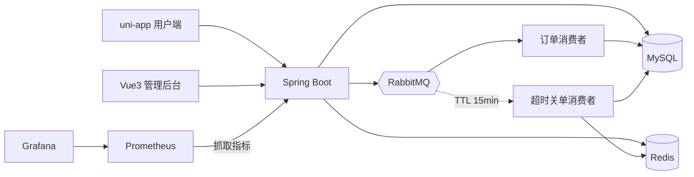

# 限时抢购交易平台 · 项目总结

> 一句话：面向限时抢购场景的交易系统，覆盖「用户抢购 → 异步下单 → 支付 / 超时关单」完整闭环，配套管理后台、用户端小程序、监控与工程化设施。

---

## 1. 项目概况

| 维度 | 数据 |
|---|---|
| 模块 | 后端（Spring Boot）+ 管理后台（Vue3）+ 用户端（uni-app） |
| 后端代码 | 58 个 Java 文件，主代码约 2435 行 |
| 接口数量 | 20 个（8 个 Controller） |
| 数据表 | 4 张（用户 / 商品 / 活动 / 订单） |
| 自动化测试 | 13 个 JUnit5 用例（4 个测试类） |
| 提交记录 | 26 次，按阶段推进，每个阶段都可运行、可验证 |
| 中间件 | MySQL 8、Redis、RabbitMQ 4.4 |

开发节奏是分四阶段推进的，每阶段结束都能独立验收：

1. **基础**：用户模块 + JWT 鉴权
2. **数据与缓存**：商品分页 / 详情、Cache-Aside 缓存、秒杀活动与库存预热
3. **并发核心**：Lua 原子扣减、一人一单、RabbitMQ 异步下单
4. **稳定性**：限流、监控、压测；之后补齐支付 / 超时关单、测试、CI、容器化

**命名约定**：对外品牌名是「限时抢购交易平台」（Flash Sale），不绑定具体行业；内部技术标识保持 `com.seckill` 包名、`seckill` 数据库、`seckill:` Redis key 前缀不变——品牌名可以随场景调整，技术命名保持稳定，避免为改名付出重建库和全量回归的代价。种子商品也已从校园品类换成通用商品（露营灯、耳机、保温杯、键盘），演示时不再有学生作业感。

---

## 2. 功能完成度

### 用户端（uni-app）

| 功能 | 状态 |
|---|---|
| 活动首页：分段筛选、倒计时、库存进度 | 已完成，H5 实测 |
| 活动详情：Redis 实时库存轮询、到点自动解锁 | 已完成，H5 实测 |
| 抢购：下单后轮询异步结果（排队中 → 成功 / 未抢到） | 已完成，H5 实测 |
| 我的订单：列表、待支付去支付、累计成交 | 已完成，H5 实测 |
| 商品列表：搜索、分类、上拉加载 | 已完成，H5 实测 |
| 登录 / 注册 | 已完成，H5 实测 |
| 微信小程序端 | 构建通过，**未在开发者工具中实测** |

### 管理后台（Vue3 + Element Plus）

| 功能 | 状态 |
|---|---|
| 登录（拦截器自动带 JWT、401 跳登录） | 已完成，浏览器实测 |
| 商品管理：增删改查、分页、搜索 | 已完成，浏览器实测 |
| 秒杀活动：新建（自动预热）、手动预热、实时库存 | 已完成，浏览器实测 |
| 订单管理：分页 | 已完成，浏览器实测 |
| 路由守卫 + 角色校验（非管理员禁止进入） | 已完成，浏览器实测 |

### 后端

| 能力 | 说明 |
|---|---|
| JWT 鉴权 + 权限分层 | 认证拦截器 + 管理员拦截器（role=1） |
| 商品缓存 | Cache-Aside、空值防穿透、TTL 随机防雪崩、更新删缓存 |
| 秒杀下单 | Lua 原子扣减、一人一单、MQ 投递失败回滚 |
| 异步下单 | 手动 ACK、双重幂等、死信队列 |
| 超时关单 | TTL + 死信延迟队列、条件更新幂等回补、定时任务兜底 |
| 支付 | 演示实现：归属校验 + 幂等 + 状态机 |
| 限流 | `@RateLimit` 注解 + AOP + Redis Lua 固定窗口 |
| 监控 | Actuator + 3 个自定义业务指标 + Prometheus 格式 |

---

## 3. 技术架构



几条贯穿全项目的约定：

- Controller 只做参数绑定，业务判断全在 Service，异常统一抛 `BusinessException(code, message)`
- Entity 与 VO 分离，控制对外暴露的字段
- Redis key 全部集中在 `CacheKeys`，避免拼错导致缓存永不命中
- 金额一律 `BigDecimal`

---

## 4. 核心技术点

### 4.1 不超卖：四道防线

| # | 防线 | 位置 | 挡住什么 |
|---|---|---|---|
| 1 | Lua 原子扣减 | `seckill.lua` | 并发读改写导致的超卖 |
| 2 | Redis Set 一人一单 | Lua 内 `SISMEMBER` | 同用户并发重复下单 |
| 3 | 唯一索引 `uk_user_activity` | 数据库 | 消息重复投递、应用层判断失效 |
| 4 | 条件更新 `WHERE status = 0` | 支付 / 关单 | 状态并发错乱、重复回补库存 |

**为什么必须用 Lua**：Redis 执行 Lua 时单线程且不可中断，「判断库存 + 扣减 + 记录用户」合成一次操作。若拆成 `GET` 再 `DECR`，并发下多个请求会读到同一库存值，直接扣成负数。

**验证**：50 个不同用户并发抢 10 件 → 恰好 10 单成功、40 个 400、库存归 0，数据库订单 10 条。

### 4.2 异步下单削峰

抢购接口只做「扣 Redis + 发 MQ」，不写数据库；消费者按自己的节奏落库。

可靠性三点：

1. **手动 ACK**：落库成功才确认，失败 `nack(requeue=false)` 进死信队列
2. **双重幂等**：先查一次 + 唯一索引兜底，重复消息直接 ACK
3. **发送失败回滚**：MQ 投递异常时把库存加回、移除参与标记，避免「扣了库存却没订单」

**验证**：活动库存 50，观察订单数 27 → 45 → 50，最终完全一致。

### 4.3 超时关单与库存回补

```
下单落库 → 延迟队列（TTL 15min，无消费者）→ 死信 → 超时队列
                                                   ↓
                        仍未支付？→ 置为已取消 + Redis 库存 +1
                        已支付 / 不存在？→ 忽略
```

- **幂等**：只有 `UPDATE ... WHERE status = 0` 影响行数为 1 时才回补，延迟消息和定时任务同时触发也只加一次
- **兜底**：定时任务每分钟扫一次超时未支付订单，防止 MQ 丢消息导致库存被永久占用
- **为什么主路径用延迟队列而不是定时扫表**：延迟队列精确到点触发、不用高频扫库；定时任务只做兜底

**验证**（临时把 TTL 改为 1 分钟）：未支付订单到期变「已取消」且库存 +1；已支付订单收到超时消息后保持不变。

### 4.4 缓存设计

- Cache-Aside：读未命中查库回写；更新 / 删除商品时**删缓存**而不是更新缓存
- 防穿透：不存在的商品缓存 `__EMPTY__` 占位，TTL 1 分钟
- 防雪崩：基础 TTL 30 分钟 + 300 秒随机抖动
- 预热安全：库存 key 刻意不设 TTL；预热前判断 key 是否存在，避免活动进行中被刷回初始库存

### 4.5 限流

`@RateLimit(type = USER, window = 1, count = 5)`，AOP + Redis Lua 固定窗口，支持 USER / IP / GLOBAL 三个维度。计数与过期时间在 Lua 内一起设置，避免 key 永不过期。

**验证**：1 秒内连打 10 次 → 首次 200、后续 4 次 409（一人一单）、其余 5 次 429。

### 4.6 权限：认证与授权分两层

- `LoginInterceptor`：校验 JWT，把 userId / role 放进 `UserContext`
- `AdminInterceptor`：拦 `/api/admin/**`，`role != 1` 返回 403
- 401（没登录）与 403（登录了但权限不够）语义分开
- 前端路由守卫只做体验层，真正判断永远在后端

**验证**：普通用户 403、管理员 200、匿名 401；浏览器中普通用户登录后台会被拒绝并清除登录态。

### 4.7 可观测性

- `/actuator/health` 聚合 db / redis / rabbit
- 自定义指标：`seckill_order_result_total{result}`、`seckill_activity_stock{activityId}`、`seckill_queue_messages{queue}`
- Grafana 12 块面板：QPS、P95、5xx 占比、状态码分布、库存水位、队列积压、JVM、GC、连接池、CPU
- 为了让 P95 能算出来，打开了 `http.server.requests` 的 `percentiles-histogram`（默认只有 summary，没有 `_bucket`）

---

## 5. 工程化实践

| 项 | 做法 |
|---|---|
| 数据库版本 | Flyway，`V1__init_schema.sql` 启动自动执行；存量库 baseline 到 0 后幂等执行 |
| 测试 | JUnit5 + MockMvc，13 个用例；独立 `seckill_test` 库 + Redis 15 号库，MQ 消费者关闭、`RabbitTemplate` mock |
| CI | GitHub Actions 三个并行 job：后端测试 + 打包、管理后台构建、用户端双目标构建；服务容器起 MySQL / Redis / RabbitMQ |
| 容器化 | Docker Compose 一键起五服务 + 监控；中间件端口不映射，避免与本机冲突 |
| 压测 | 零依赖 Node 脚本 `scripts/loadtest.mjs`，自动注册用户并并发抢购，输出 QPS / P50 / P95 / P99 |
| 文档 | README（快速开始 / API / 设计摘要）+ `docs/architecture.md`（链路时序、故障兜底）+ 界面截图 |

---

## 6. 实测数据

### 功能验证

| 场景 | 结果 |
|---|---|
| 超卖 | 50 并发抢 10 件 → 10 成功、40 个 400、库存 0 |
| 一人一单 | 同账号重复请求 → 首次 200，之后 409 |
| 限流 | 1 秒 10 次 → 200×1、409×4、429×5 |
| 权限 | 管理接口 403 / 200 / 401 |
| 异步最终一致 | 库存 50 → 订单 27 → 45 → 50 |
| 超时关单 | 未支付到期 → 已取消、库存 +1；已支付不受影响 |
| 支付 | 幂等、他人订单 404、已取消订单不可支付 |

### 压测（后端与中间件同机）

| 场景 | 请求数 | 初始库存 | 成功 | 总耗时 | QPS | P95 |
|---|---|---|---|---|---|---|
| 超卖验证 | 50 | 10 | 10 | 334 ms | 149.7 | 326 ms |
| 吞吐 | 200 | 200 | 200 | 816 ms | 245.1 | 746 ms |

两轮结束后 Redis 库存均为 0，订单数分别为 10 / 200，未出现负数。

---

## 7. 踩坑记录

1. **uni-app 活动详情页会让 H5 渲染进程卡死**
   按区块二分重建后恢复正常。结论不是某个组件的锅，而是整页组合出的问题；重建时把抢购状态机、骨架屏一并补全。

2. **Spring Boot 3.5 测试上下文没有 `RabbitAdmin` bean**
   `MetricsConfig` 注入 `RabbitAdmin` 导致 13 个用例全部启动失败。改为用 `ConnectionFactory` 自己 `new RabbitAdmin(...)`，主应用与测试都能跑。

3. **Grafana 算不出 P95**
   Micrometer 默认只导出 summary，没有 `_bucket`，`histogram_quantile` 返回空。在 `application.yml` 打开 `percentiles-histogram` 后才拿到分位数。

4. **Windows 中文主机名导致 RabbitMQ 节点名非法**
   显式指定 `RABBITMQ_NODENAME=rabbit@localhost`、`ERLANG_HOME`、`RABBITMQ_BASE` 才能启动。

5. **npm install 在受限环境下调用 `cmd.exe` 失败**
   postinstall 脚本被沙箱拦截，改用 `--ignore-scripts` 完成安装（CI 环境正常，无需该参数）。

6. **推送含 workflow 文件被 GitHub 拒绝**
   OAuth token 缺少 `workflow` scope，执行 `gh auth refresh -s workflow` 后解决。

7. **Docker Compose 与本机中间件端口冲突**
   中间件端口不映射到宿主机，容器间用服务名互访，只暴露 8080 / 8081 / 15672 / 9090 / 3000。

---

## 8. 不足与后续

| 不足 | 影响 | 后续方案 |
|---|---|---|
| 支付是演示实现 | 没有真实渠道与回调 | 接支付 SDK，回调验签 + 幂等处理 |
| 小程序端未实测 | 只验证了构建 | 微信开发者工具 + 真机跑一遍全流程 |
| Docker Compose 未实跑 | 配置仅做 schema 校验 | 本机装 Docker 后 `up -d --build` 验证 |
| 商品 / 活动 CRUD 未覆盖测试 | 回归风险 | 补 MockMvc 用例 |
| JWT 无刷新与登出失效 | 安全性一般 | refresh token + 黑名单 |
| 定时任务单机 | 多实例会重复预热 | ShedLock 或 XXL-JOB |
| 单机部署 | 无法水平扩容 | 无状态化后端 + Nginx 负载均衡 |

---

## 9. 简历与面试

> 完整的按模块问答清单（约 45 题，含追问与答题建议）见 [interview-qa.md](interview-qa.md)。

### 简历描述（参考）

- 基于 **Redis + Lua** 实现库存原子扣减，配合数据库唯一索引与条件更新构建四道防线；**50 并发抢 10 件实测恰好 10 单、零超卖**
- 基于 **RabbitMQ** 实现异步下单与 TTL + 死信延迟队列，手动 ACK + 双重幂等 + 失败回滚；**200 并发下单 816ms、QPS 245**，订单最终一致
- 工程化落地：Flyway 迁移、**13 个 JUnit5 用例**、GitHub Actions 三 job CI、Docker Compose、**Prometheus + Grafana 12 面板监控**

### 高频追问与答题要点

1. **为什么用 Lua，不用分布式锁？**
   Lua 在 Redis 内原子执行，无锁竞争；分布式锁会让并发串行化，吞吐显著下降，而秒杀要的正是吞吐。

2. **为什么延迟队列，不直接定时扫表？**
   延迟队列到点触发、精度高、不压数据库；定时任务只做兜底（MQ 丢消息的情况）。

3. **怎么保证不重复下单？**
   三层：Redis Set 在 Lua 里挡并发、唯一索引兜底、MQ 消费先查一次 + `DuplicateKeyException` 也算成功。

4. **消息丢了怎么办？**
   发送失败同步回滚 Redis；消费失败进死信；超时关单另有定时补偿任务。

5. **缓存一致性怎么做的？**
   Cache-Aside + 更新时删缓存（不更新缓存），避免并发写覆盖；代价是下一次读回源。

6. **怎么证明零超卖？**
   两条独立证据：JUnit 并发用例断言成功数 = 库存数；压测脚本跑完对账 Redis 库存与数据库订单数。

7. **瓶颈在哪？**
   单机 JVM、单消费者、数据库连接池；横向扩展需要无状态化 + 多消费者 + 分布式锁保护定时任务。

8. **为什么支付是模拟的？**
   项目重点是秒杀链路的并发正确性，支付渠道不是考察点；但保留了订单状态机、归属校验与幂等，接真实渠道时只需替换实现。
